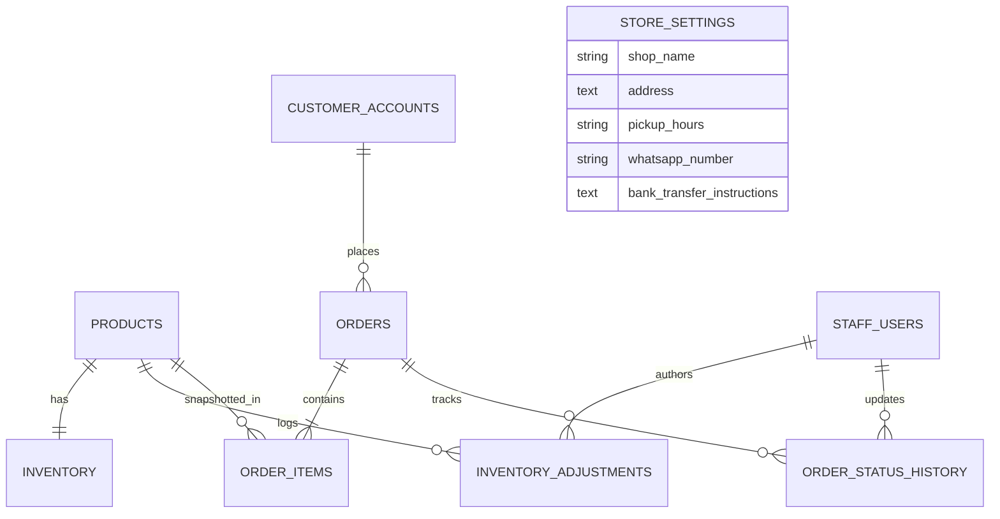

# Data Model & Relational Schema Specification

Status: Authoritative Schema Blueprint  
Database Engine: PostgreSQL  
Source: [`docs/PRD.md`](file:///Users/shofwanasy/projects/santo-groceries/docs/PRD.md) §2, §4  
Last Updated: 2026-10-09  

---

## 1. Entity Relationship Overview

---

## 2. Table Specifications

### 2.1 `products`
Stores the active catalog of grocery products.

| Column | Type | Constraints | Description |
| :--- | :--- | :--- | :--- |
| `id` | `UUID` | `PRIMARY KEY, DEFAULT gen_random_uuid()` | Unique product identifier |
| `name` | `VARCHAR(255)` | `NOT NULL` | Product name (Bahasa Indonesia) |
| `category` | `VARCHAR(100)` | `NOT NULL, INDEX` | Grocery category (e.g., Beras, Minyak, Telur) |
| `selling_unit` | `VARCHAR(50)` | `NOT NULL` | Unit of measure (e.g., `kg`, `liter`, `pcs`, `ikat`) |
| `price_idr` | `BIGINT` | `NOT NULL, CHECK (price_idr >= 0)` | Price in integer Rupiah |
| `image_url` | `TEXT` | `NULLABLE` | Image path or fallback placeholder |
| `is_active` | `BOOLEAN` | `NOT NULL DEFAULT true` | Active flag; deactivated items cannot be ordered |
| `created_at` | `TIMESTAMPTZ` | `NOT NULL DEFAULT clock_timestamp()` | Creation timestamp |
| `updated_at` | `TIMESTAMPTZ` | `NOT NULL DEFAULT clock_timestamp()` | Update timestamp |

### 2.2 `inventory`
Tracks physical and reserved stock balances per product.

| Column | Type | Constraints | Description |
| :--- | :--- | :--- | :--- |
| `product_id` | `UUID` | `PRIMARY KEY, REFERENCES products(id) ON DELETE RESTRICT` | Associated product |
| `on_hand` | `INTEGER` | `NOT NULL, CHECK (on_hand >= 0)` | Physical units present in store |
| `reserved` | `INTEGER` | `NOT NULL, CHECK (reserved >= 0)` | Units allocated to active uncollected orders |
| `updated_at` | `TIMESTAMPTZ` | `NOT NULL DEFAULT clock_timestamp()` | Balance update timestamp |

> [!IMPORTANT]
> **Core Check Constraint**:  
> `CONSTRAINT chk_on_hand_ge_reserved CHECK (on_hand >= reserved)`  
> Available stock is always calculated as `(on_hand - reserved)`.

### 2.3 `inventory_adjustments`
Audit log of manual inventory adjustments by staff.

| Column | Type | Constraints | Description |
| :--- | :--- | :--- | :--- |
| `id` | `UUID` | `PRIMARY KEY, DEFAULT gen_random_uuid()` | Unique log ID |
| `product_id` | `UUID` | `NOT NULL, REFERENCES products(id)` | Target product |
| `actor_id` | `UUID` | `NOT NULL, REFERENCES staff_users(id)` | Staff member recording change |
| `change_qty` | `INTEGER` | `NOT NULL` | Delta quantity (+/- integer) |
| `reason` | `VARCHAR(255)` | `NOT NULL` | Reason note (e.g., restock, damage, offline sale) |
| `created_at` | `TIMESTAMPTZ` | `NOT NULL DEFAULT clock_timestamp()` | Timestamp |

### 2.4 `orders`
Authoritative master record of customer grocery orders.

| Column | Type | Constraints | Description |
| :--- | :--- | :--- | :--- |
| `id` | `UUID` | `PRIMARY KEY, DEFAULT gen_random_uuid()` | Internal unique order ID |
| `reference_code` | `VARCHAR(32)` | `UNIQUE, NOT NULL, INDEX` | Human-readable code (e.g., `ORD-202610-0042`) |
| `guest_token_hash` | `VARCHAR(64)` | `NULLABLE, INDEX` | SHA-256 hash of secret guest token (null if registered) |
| `customer_id` | `UUID` | `NULLABLE, REFERENCES customer_accounts(id)` | Associated customer account (null if guest) |
| `customer_name` | `VARCHAR(150)` | `NOT NULL` | Customer name provided at checkout |
| `whatsapp_number` | `VARCHAR(50)` | `NOT NULL` | Customer contact number (E.164/ID standard) |
| `order_state` | `VARCHAR(30)` | `NOT NULL, DEFAULT 'submitted'` | State: `submitted`, `accepted`, `preparing`, `ready_for_pickup`, `collected`, `cancelled` |
| `payment_state` | `VARCHAR(30)` | `NOT NULL, DEFAULT 'pending'` | Payment status: `pending`, `confirmed` |
| `payment_method` | `VARCHAR(30)` | `NOT NULL` | `bank_transfer` or `pay_at_store` |
| `total_amount_idr`| `BIGINT` | `NOT NULL, CHECK (total_amount_idr >= 0)` | Total order value in integer IDR |
| `idempotency_key` | `VARCHAR(128)` | `UNIQUE, NOT NULL` | Client-supplied submission idempotency token |
| `payload_hash` | `VARCHAR(64)` | `NOT NULL` | SHA-256 checksum of request items to verify idempotency |
| `cancellation_reason` | `VARCHAR(255)` | `NULLABLE` | Mandatory if cancelled; indicates if due to incorrect stock |
| `refund_notes` | `TEXT` | `NULLABLE` | Staff notes if manual refund was executed for confirmed payment |
| `refund_bank_ref` | `VARCHAR(100)` | `NULLABLE` | Optional bank transfer reference for processed refund |
| `refund_date` | `DATE` | `NULLABLE` | Optional settlement date for processed refund |
| `guest_token_expires_at` | `TIMESTAMPTZ` | `NULLABLE` | Expiration timestamp for guest access token (30 days from creation) |
| `created_at` | `TIMESTAMPTZ` | `NOT NULL DEFAULT clock_timestamp()` | Order placement timestamp |
| `updated_at` | `TIMESTAMPTZ` | `NOT NULL DEFAULT clock_timestamp()` | Last status modification timestamp |

### 2.5 `order_items`
Immutable line-item snapshot of products purchased in an order.

| Column | Type | Constraints | Description |
| :--- | :--- | :--- | :--- |
| `id` | `UUID` | `PRIMARY KEY, DEFAULT gen_random_uuid()` | Line item ID |
| `order_id` | `UUID` | `NOT NULL, REFERENCES orders(id) ON DELETE CASCADE` | Associated order |
| `product_id` | `UUID` | `NOT NULL, REFERENCES products(id)` | Referenced catalog product |
| `name_snapshot` | `VARCHAR(255)` | `NOT NULL` | Product name at time of order |
| `unit_snapshot` | `VARCHAR(50)` | `NOT NULL` | Selling unit at time of order |
| `price_idr_snapshot`| `BIGINT` | `NOT NULL` | Unit price in IDR at time of order |
| `quantity` | `INTEGER` | `NOT NULL, CHECK (quantity > 0)` | Ordered integer quantity |
| `line_total_idr` | `BIGINT` | `NOT NULL` | `price_idr_snapshot * quantity` |

### 2.6 `order_status_history`
Audit trail of state transitions for orders and payments.

| Column | Type | Constraints | Description |
| :--- | :--- | :--- | :--- |
| `id` | `UUID` | `PRIMARY KEY, DEFAULT gen_random_uuid()` | Audit log ID |
| `order_id` | `UUID` | `NOT NULL, REFERENCES orders(id)` | Target order |
| `from_state` | `VARCHAR(30)` | `NOT NULL` | Pre-transition state |
| `to_state` | `VARCHAR(30)` | `NOT NULL` | Post-transition state |
| `actor_type` | `VARCHAR(20)` | `NOT NULL` | `customer`, `staff`, or `system` |
| `actor_id` | `UUID` | `NULLABLE` | ID of acting user |
| `notes` | `TEXT` | `NULLABLE` | Transition context or reason |
| `created_at` | `TIMESTAMPTZ` | `NOT NULL DEFAULT clock_timestamp()` | Event timestamp |

### 2.7 `store_settings`
Singleton configuration table editable by authorized staff.

| Column | Type | Constraints | Description |
| :--- | :--- | :--- | :--- |
| `id` | `INTEGER` | `PRIMARY KEY DEFAULT 1 CHECK (id = 1)` | Singleton row enforcement |
| `shop_name` | `VARCHAR(150)` | `NOT NULL` | Store name |
| `address` | `TEXT` | `NOT NULL` | Physical store address |
| `pickup_hours` | `VARCHAR(255)` | `NOT NULL` | In-store pickup operating hours |
| `whatsapp_number` | `VARCHAR(50)` | `NOT NULL` | Store official WhatsApp phone number |
| `bank_instructions` | `TEXT` | `NOT NULL` | Bank name, account number, account holder name |
| `updated_at` | `TIMESTAMPTZ` | `NOT NULL DEFAULT clock_timestamp()` | Last update timestamp |

### 2.8 `staff_users` & `customer_accounts`

#### `staff_users`
Internal store staff and administration:
| Column | Type | Constraints | Description |
| :--- | :--- | :--- | :--- |
| `id` | `UUID` | `PRIMARY KEY, DEFAULT gen_random_uuid()` | Staff account ID |
| `username` | `VARCHAR(50)` | `UNIQUE, NOT NULL` | Staff login username |
| `password_hash` | `VARCHAR(255)` | `NOT NULL` | Bcrypt/Argon2 password hash |
| `role` | `VARCHAR(30)` | `NOT NULL DEFAULT 'staff'` | `admin` or `staff` |
| `is_active` | `BOOLEAN` | `NOT NULL DEFAULT true` | Active account status |
| `created_at` | `TIMESTAMPTZ` | `NOT NULL DEFAULT clock_timestamp()` | Creation timestamp |

#### `customer_accounts`
Registered customer accounts (per ADR 0006):
| Column | Type | Constraints | Description |
| :--- | :--- | :--- | :--- |
| `id` | `UUID` | `PRIMARY KEY, DEFAULT gen_random_uuid()` | Customer account ID |
| `name` | `VARCHAR(150)` | `NOT NULL` | Customer full name |
| `email` | `VARCHAR(255)` | `UNIQUE, NOT NULL, INDEX` | Account email address |
| `password_hash` | `VARCHAR(255)` | `NOT NULL` | Bcrypt/Argon2 password hash |
| `phone_number` | `VARCHAR(50)` | `NOT NULL` | Contact phone / WhatsApp number |
| `is_verified` | `BOOLEAN` | `NOT NULL DEFAULT false` | Email verification flag |
| `reset_token_hash`| `VARCHAR(64)` | `NULLABLE, INDEX` | SHA-256 hash of password reset token |
| `reset_token_expires_at` | `TIMESTAMPTZ` | `NULLABLE` | Expiration of password reset token |
| `created_at` | `TIMESTAMPTZ` | `NOT NULL DEFAULT clock_timestamp()` | Registration timestamp |
| `updated_at` | `TIMESTAMPTZ` | `NOT NULL DEFAULT clock_timestamp()` | Modification timestamp |
