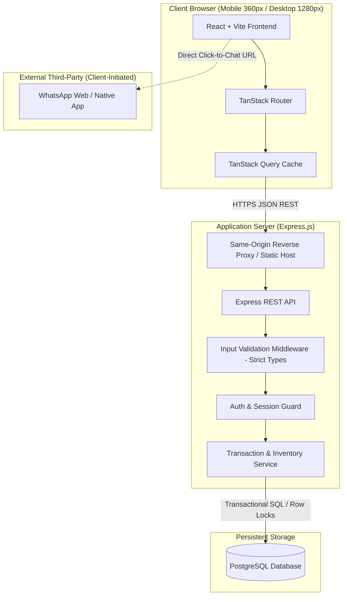

# Architecture Overview

Status: Approved Technical Direction  
Source: [`docs/PRD.md`](file:///Users/shofwanasy/projects/santo-groceries/docs/PRD.md) §4  
Last Updated: 2026-10-09  

---

## 1. System Topology

The Online Grocery Ordering application is designed as a streamlined, monolithic full-stack application deployed with a unified same-origin topology to maximize security, simplify cookie/session management, and minimize operational overhead.



---

## 2. Core Architectural Principles

### 2.1 Unified Order Processing Path
Both guest customers and registered customers share the identical order processing pipeline (`POST /api/v1/orders`). The order record associates optionally with a `customer_id` if authenticated, and generates a non-enumerable secret access token hash for guest lookup.

### 2.2 Relational Source of Truth
PostgreSQL serves as the single source of truth for:
* Product catalog, categories, selling units, and IDR prices.
* Real-time inventory balances (`on_hand`, `reserved`, `available`).
* Order entities, line item historical snapshots, and status transition logs.
* Staff administrative credentials and audit adjustment records.

### 2.3 Strict Transactional Boundaries
All operations mutating inventory or placing orders must execute inside an ACID transaction (`SERIALIZABLE` or `READ COMMITTED` with explicit `SELECT ... FOR UPDATE` row locks):
```sql
BEGIN;
-- 1. Lock target product inventory rows
SELECT product_id, on_hand, reserved 
FROM inventory 
WHERE product_id IN (...) 
FOR UPDATE;

-- 2. Verify availability >= requested
-- 3. Insert order record and item snapshots
-- 4. Increment reserved stock
-- 5. Commit atomically
COMMIT;
```

### 2.4 Decoupled External Handoff
External integrations (specifically WhatsApp and customer banking apps) are strictly decoupled from system persistence:
* WhatsApp is opened by the client browser via prefilled `https://wa.me/` URLs.
* The application server has zero dependencies on external third-party webhooks, message queues, or delivery acknowledgments.
