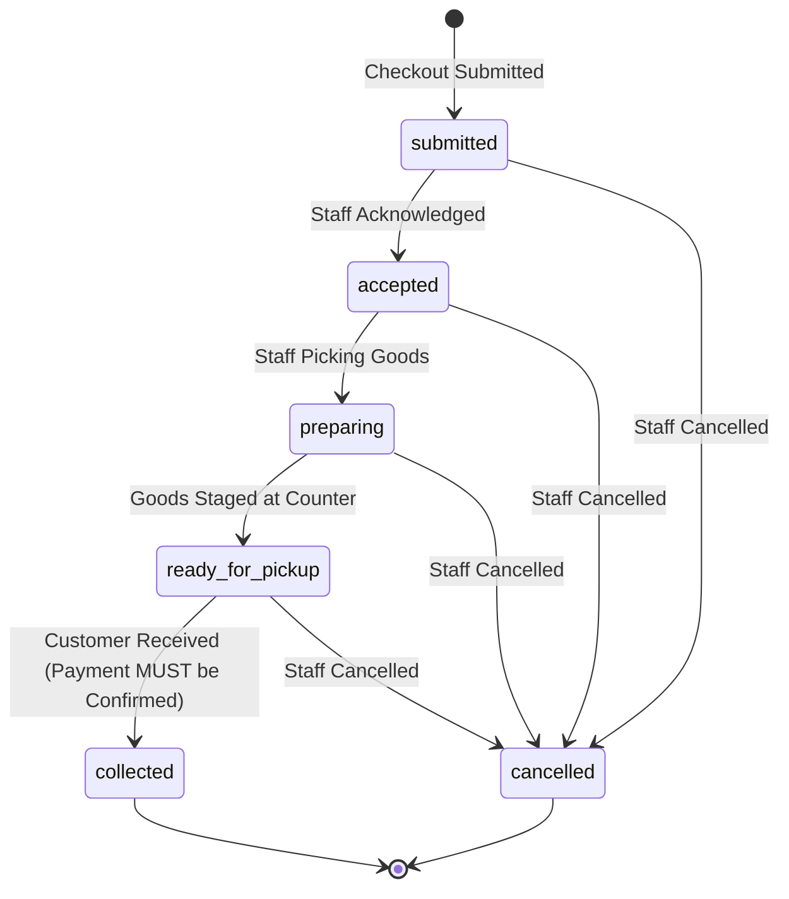

# Business Rules & Domain Invariants

Status: Authoritative Domain Specification  
Source: [`docs/PRD.md`](file:///Users/shofwanasy/projects/santo-groceries/docs/PRD.md)  
Last Updated: 2026-10-09  

---

## 1. Domain Invariants Summary

The following invariants are absolute constraints enforced by the domain layer and database integrity rules.

| Invariant Code | Name | Rule Definition |
| :--- | :--- | :--- |
| `INV-01` | **Available Stock Formula** | $\text{available\_stock} = \text{on\_hand\_stock} - \text{reserved\_stock}$. The system must guarantee $\text{on\_hand} \ge \text{reserved}$ at all times. |
| `INV-02` | **Atomic Checkout & Reservation** | Checkout atomically creates an order record and reserves inventory in a single database transaction. No partial reservation or unreserved order is permitted. |
| `INV-03` | **Idempotent Checkout** | Identical requests with the same `Idempotency-Key` return the original order. No duplicate order or duplicate reservation may occur. Modifying order payload under an existing key returns `409 Conflict`. |
| `INV-04` | **Integer Currency Arithmetic** | All customer-facing prices, line totals, and order subtotals are non-negative integer Indonesian Rupiah (`IDR`). Floating-point values are strictly forbidden. |
| `INV-05` | **At-Most-Once Inventory Lifecycle** | Order status mutations apply inventory changes atomically and at most once. Idempotent replays of state changes do not adjust stock a second time. |
| `INV-06` | **Collection Irreversibility** | Orders in `collected` state cannot be cancelled via the standard cancellation workflow. |
| `INV-07` | **Payment Precedes Collection** | An order cannot transition to `collected` while `payment_state == pending`. |
| `INV-08` | **Guest Access Isolation** | Human-readable order references alone cannot expose private order details or customer information. Access requires a high-entropy secret token. |
| `INV-09` | **Decoupled WhatsApp Source of Truth** | WhatsApp is strictly an external handoff and never the source of truth for order presence or state. |

---

## 2. Inventory Math & State Mutations

Inventory is tracked per active product across three core metrics:
* `on_hand`: Physical units currently located inside the store.
* `reserved`: Units allocated to active, uncollected, and uncancelled online orders.
* `available`: Calculated as $\text{on\_hand} - \text{reserved}$.

### Lifecycle Operations Matrix

| Operational Event | Action Trigger | Effect on `on_hand` | Effect on `reserved` | Effect on `available` | Notes |
| :--- | :--- | :--- | :--- | :--- | :--- |
| **Order Placement** | Customer submits checkout | None ($0$) | $+Q$ | $-Q$ | Evaluated inside lock transaction. Fails if $\text{available} < Q$. |
| **Order Collection** | Staff marks order collected | $-Q$ | $-Q$ | None ($0$) | Physically departs store. Both decrease together. |
| **Order Cancellation** | Staff cancels order | None ($0$) | $-Q$ | $+Q$ | Reservation released back to available catalog. |
| **Manual Restock** | Staff records inventory intake | $+A$ | None ($0$) | $+A$ | Reason logged. |
| **Manual Shrinkage / Offline Sale** | Staff adjusts store count | $-A$ | None ($0$) | $-A$ | Rejected if $\text{on\_hand} - A < \text{reserved}$. |

---

## 3. Order State Machine

Orders follow a strict unidirectional progression, with cancellation allowed from any pre-collection state.

### Allowed Transitions Table

| From State | Allowed Target States | Conditions / Guards | Inventory Effect |
| :--- | :--- | :--- | :--- |
| `submitted` | `accepted`, `cancelled` | Cancellation requires staff actor & reason | If cancelled: release reservation |
| `accepted` | `preparing`, `cancelled` | Cancellation requires staff actor & reason | If cancelled: release reservation |
| `preparing` | `ready_for_pickup`, `cancelled` | Cancellation requires staff actor & reason | If cancelled: release reservation |
| `ready_for_pickup` | `collected`, `cancelled` | **Transition to `collected` requires `payment_state == confirmed`**. | If collected: decrement on-hand & reserved. If cancelled: release reservation. |
| `collected` | *(Terminal)* | **No transitions permitted.** Cannot be cancelled via standard workflow. | None (already applied). |
| `cancelled` | *(Terminal)* | **No transitions permitted.** | None (already released). |

---

## 4. Payment State Machine

Payment state is decoupled from the order lifecycle state, reflecting the realities of manual verification in a small retail store.

| Payment State | Description | Allowed Next State | Action / Actor |
| :--- | :--- | :--- | :--- |
| `pending` | Initial state upon checkout for both `bank_transfer` and `pay_at_store`. | `confirmed` | Confirmed manually by staff after reviewing bank account or receiving cash. |
| `confirmed` | Funds verified in bank account or cash received at store counter. | *(Terminal in standard flow)* | Order may now be marked `collected`. |

### Crucial Inter-State Invariant
$$\text{order\_state} = \text{collected} \implies \text{payment\_state} = \text{confirmed}$$

---

## 5. Currency & Financial Calculations

1. **Denomination**: All prices are specified in Indonesian Rupiah (`IDR`).
2. **Data Representation**: Must be stored as 64-bit integer (`BIGINT` or integer in DB, `number` or `bigint` in TypeScript). No float or decimal types with fractional cents.
3. **Formulae**:
   * Item line total: $\text{line\_total} = \text{unit\_price\_idr} \times \text{quantity}$
   * Order total: $\text{order\_total} = \sum \text{line\_total}$
4. **No Hidden Fees**: In the MVP, there are no delivery fees, handling fees, or platform fees. Total equals the sum of line totals.
