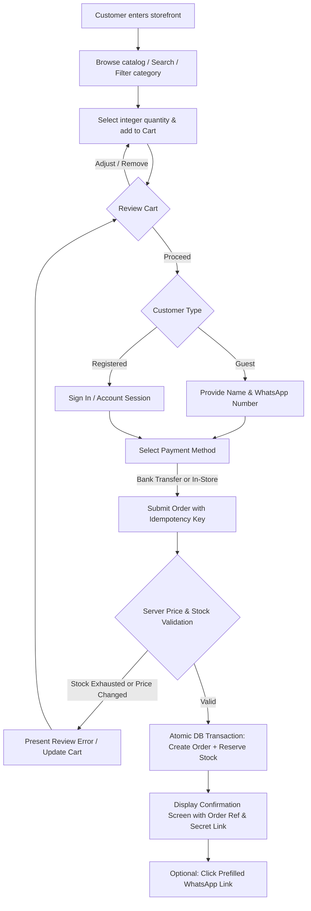
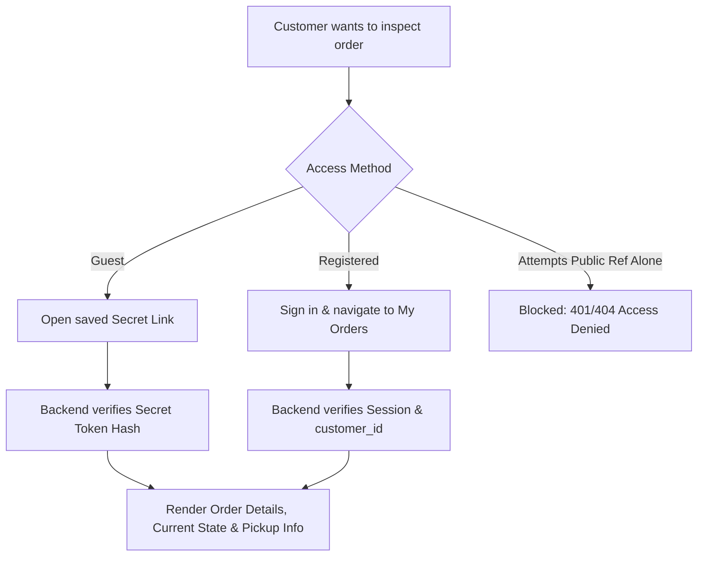
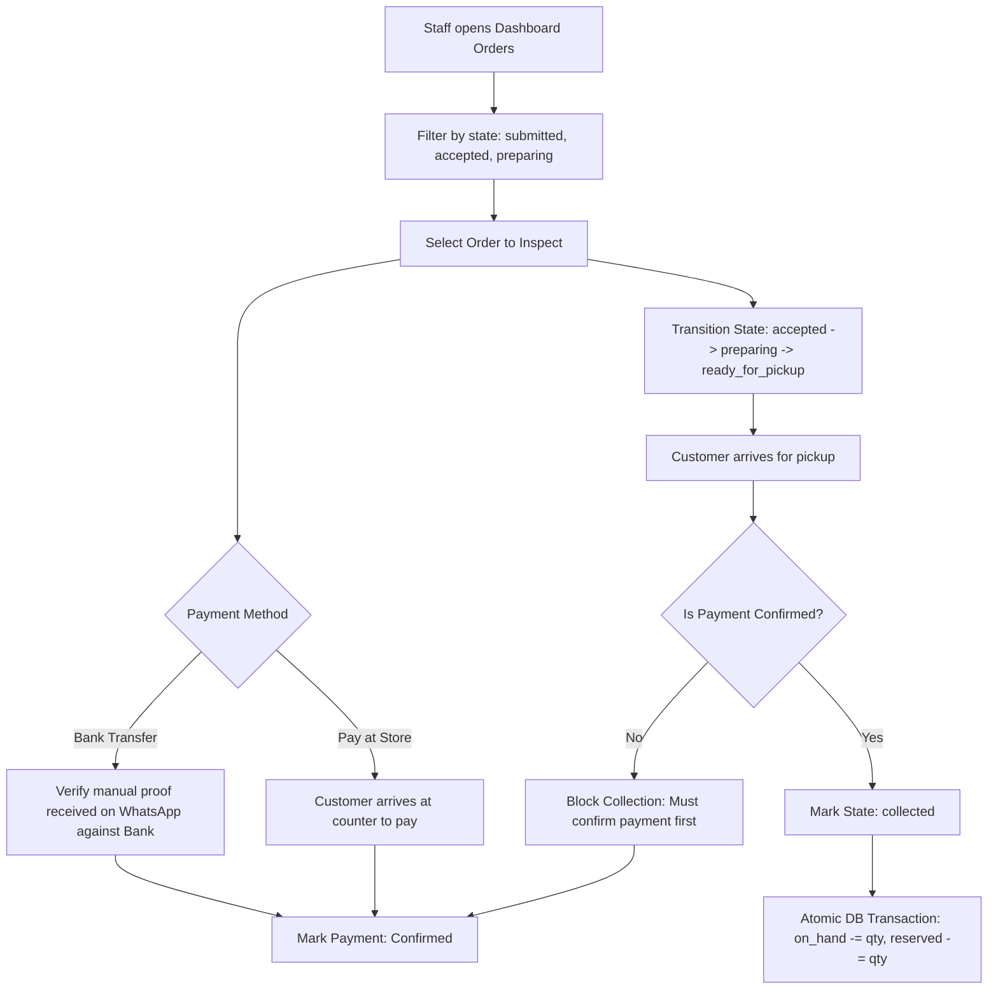
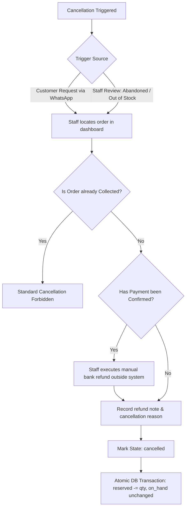

# User Flows & Operational Journeys

Status: Derived from [`docs/PRD.md`](file:///Users/shofwanasy/projects/santo-groceries/docs/PRD.md)  
Last Updated: 2026-10-09  

---

## 1. Customer Journey: Browse, Cart & Checkout

### 1.1 Step-by-Step Breakdown
1. **Catalog Exploration**: Customer searches products or filters by category. Live on-hand and reserved levels define availability (`on_hand - reserved`). Items with 0 availability are disabled from cart addition.
2. **Cart Building**: Customer inputs positive integer quantities. Line totals and order subtotal are computed in IDR.
3. **Checkout Selection**:
   * **Guest**: Enters recipient full name and valid Indonesian WhatsApp phone number.
   * **Registered**: Authenticates with existing account; previous order history becomes accessible.
   * **Fulfillment**: Fixed to In-Store Pickup (*Ambil di Toko*).
   * **Payment Method**: Chooses either Bank Transfer (*Transfer Bank*) or Pay at Store (*Bayar di Toko*).
4. **Order Submission**: Client dispatches `POST /api/v1/orders` with an `Idempotency-Key` header.
5. **Server Transaction**:
   * Evaluates current product catalog prices.
   * Acquires row locks on target inventory records.
   * Verifies `available >= requested_qty`.
   * Inserts order and order item snapshots.
   * Increments `reserved` stock by `requested_qty`.
   * Returns order reference code and non-enumerable secret guest access token.
6. **Order Confirmation & External Handoff**:
   * Confirmation UI renders the order summary, bank transfer instructions (if applicable), store physical address, and pickup hours.
   * Renders a `Hubungi Toko via WhatsApp` button linking to `https://wa.me/<store_number>?text=<encoded_summary>`.
   * The customer may safely close the browser; the order is securely stored.

---

## 2. Customer Journey: Order Status Inspection

### 2.1 Guest Order Access
* Guests receive a unique URL at checkout: `/orders/guest?token=<secret_token>`.
* The server hashes the incoming token and looks up the corresponding order.
* Public order references (e.g., `ORD-202610-0012`) cannot be used alone to view customer phone numbers, names, or item breakdowns.

---

## 3. Staff Journey: Order Processing & Pickup

### 3.1 Order State Transitions
1. **`submitted`**: Initial state upon successful checkout. Inventory is reserved.
2. **`accepted`**: Staff acknowledges receipt and validates order feasibility.
3. **`preparing`**: Staff physically picks groceries from store shelves.
4. **`ready_for_pickup`**: Goods are bagged and staged at the counter. Staff may notify customer manually via WhatsApp.
5. **`collected`**: Customer takes possession of goods. **Payment must be `confirmed` before this step.** Decrements both `on_hand` and `reserved`.

---

## 4. Staff Journey: Order Cancellation & Inventory Release

### 4.1 Cancellation Business Rules
* Any uncollected order (`submitted`, `accepted`, `preparing`, `ready_for_pickup`) can be cancelled by staff.
* Cancellation reasons must be recorded (e.g., `customer_request`, `abandoned_unpaid`, `incorrect_stock`).
* If payment was already marked `confirmed`, staff must handle the refund manually through banking channels before recording resolution.
