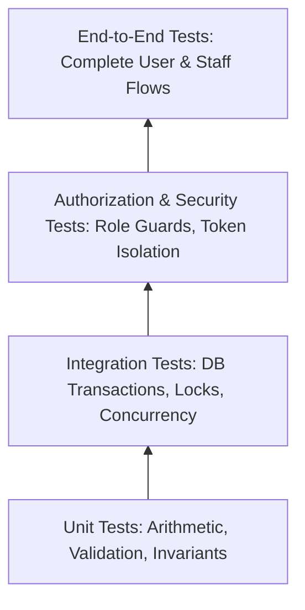

# Testing Strategy & Quality Assurance

Status: Approved QA Specification & Release Gates  
Source: [`docs/PRD.md`](file:///Users/shofwanasy/projects/santo-groceries/docs/PRD.md) §4  
Last Updated: 2026-10-09  

---

## 1. Testing Pyramid & Test Types

Quality assurance for the Online Grocery Ordering application is structured across four rigorous testing tiers:

### 1.1 Unit Tests
* **Coverage**: Pure business logic, integer IDR math calculations, state transition validation rules, input sanitizers, and inventory calculation formulas ($\text{available} = \text{on\_hand} - \text{reserved}$).
* **Execution**: Fast, in-memory, zero database dependencies.

### 1.2 Integration & Concurrency Tests
* **Coverage**: Database transactions against a real PostgreSQL instance:
  * Price recalculation and cart review triggers.
  * Transactional stock reservation and atomic commit/rollback.
  * Idempotency duplicate detection and payload mismatch rejection.
  * **Concurrency Harness**: Simulating simultaneous checkouts when 1 unit remains in stock.
  * Verification that manual stock adjustments cannot reduce on-hand below reserved quantities.

### 1.3 Authorization & Security Tests
* **Coverage**:
  * Rejecting unauthenticated access to all staff endpoints.
  * Preventing Customer $A$ from accessing orders placed by Customer $B$.
  * Verifying that querying an order by human-readable reference alone returns authorization errors.
  * Testing CSRF rejection on state-mutating requests.

### 1.4 End-to-End (E2E) & Acceptance Tests
* **Coverage**: Full journey execution in browser automation:
  * Guest checkout with Bank Transfer and Pay at Store.
  * Pre-filled WhatsApp link verification (validating query parameter encoding).
  * Staff dashboard: reviewing order, confirming payment, preparing, and marking collected.
  * Staff cancellation: verifying reserved stock restoration.
  * Verifying an order remains fully visible and actionable in the dashboard even if WhatsApp is never opened.

---

## 2. Release & Quality Gates

Before any production deployment or pilot rollout, the system must satisfy the following mandatory gates:

### Gate 1: Automated CI Pipeline
* 100% pass rate on frontend and backend strict TypeScript type checking (`tsc --noEmit`).
* 100% pass rate on all unit, integration, and security test suites.

### Gate 2: Usability & Accessibility Gate
* Storefront (catalog, cart, checkout, confirmation) and staff dashboard must remain fully operable at:
  * **360px** mobile viewport width.
  * **1280px** desktop viewport width.
* Zero horizontal overflow scrolling or overlapping controls.
* Primary interactive flows must support keyboard navigation and properly labeled form inputs.

### Gate 3: Proposed Performance Gate
* With 500 active products in the database and 10 concurrent active users:
  * Catalog list (`GET /api/v1/products`) response time: $p95 \le 1.0\text{s}$.
  * Checkout submission (`POST /api/v1/orders`) response time: $p95 \le 1.0\text{s}$.
  *(Excludes product image asset downloads and external WhatsApp navigation).*

### Gate 4: Staff Acceptance Testing
* Designated store staff must independently complete acceptance scenarios without developer assistance:
  * Editing catalog products and prices.
  * Adjusting inventory count with reason note.
  * Verifying a bank transfer payment.
  * Progressing an order to ready for pickup and recording collection.
  * Cancelling an order and logging the cancellation reason.

### Gate 5: Backup & Disaster Recovery Verification
* Full backup creation and a successful end-to-end database restoration must be demonstrated on staging before production launch.
